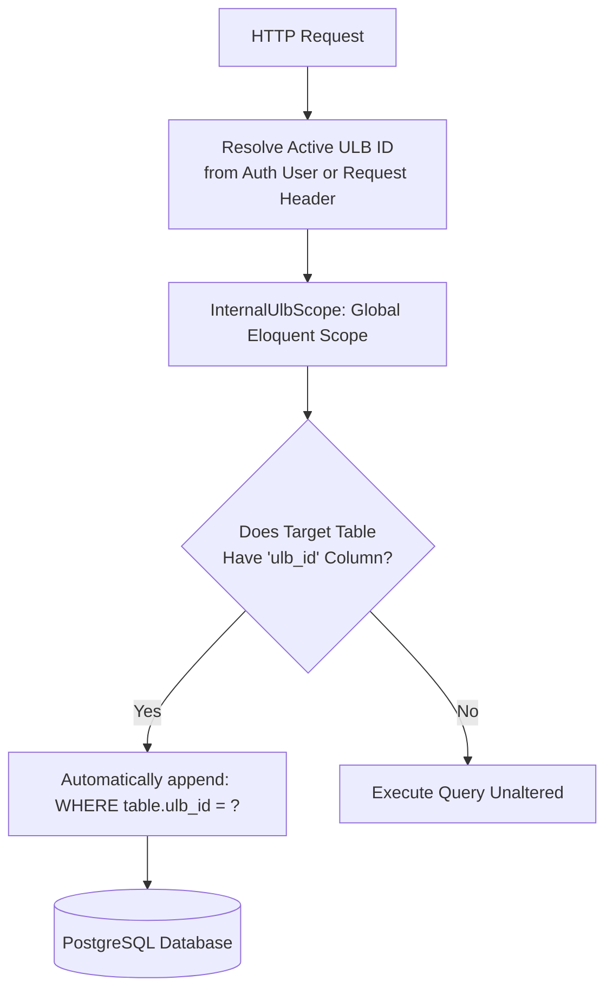

# Phase 1 Discovery: Middleware, Authentication & Authorization Architecture

## 1. Executive Summary

In `egov-backend`, authentication and authorization are structured around an API Gateway model:
- **Upstream Gateway**: The client communicates through an authentication gateway (e.g., `Authorisation-Service`), which validates credentials, generates or verifies JWT/Sanctum tokens, and proxies requests to `egov-backend` with serialized user identity payloads (`$request->auth` and `$request->currentAccessToken`).
- **Domain Hydration (`AuthMaker`)**: The `AuthMaker` middleware unpacks `$request->auth`, instantiates either an employee/official user (`App\Models\User`) or a citizen (`App\Models\ActiveCitizen`), and logs them into Laravel's session state (`Auth::login()`).
- **Multi-Tenant Scoping (`UlbFilter`)**: All queries are automatically scoped by Urban Local Body (`ulb_id`) using an Eloquent Global Scope (`InternalUlbScope`) and query interceptor.
- **Workflow & Ward Authorization (`WardPermission`)**: Fine-grained role permissions and ward restrictions are enforced at the repository and controller levels using Redis-backed role caching (`wf_roleusermaps`, `wf_workflowrolemaps`, `ulb_ward_masters`).

---

## 2. Complete Middleware Portfolio

The application defines 17 middleware in `app/Http/Middleware/`, registered across global, group, and route-specific stacks in `app/Http/Kernel.php`:

| Middleware Class | Alias / Group | Function & Execution Mechanics |
|---|---|---|
| `ForceJsonResponse` | `json.response` | Checks if URI begins with `api/*` and forces the `Accept: application/json` HTTP header to ensure consistent JSON API responses. |
| `AuthMaker` | `auth_maker` | Decodes `$request->auth` and `$request->currentAccessToken`. Automatically calls `Auth::login()` with `App\Models\User` (if `tokenable_type == 'App\Models\Auth\User'`) or `App\Models\ActiveCitizen`. Maps all auth attributes directly onto the authenticated user instance. |
| `ApiLogger` | `apilogger` | Calculates total execution time in milliseconds (`LARAVEL_START` to end). Inspects `$response->getContent()`. If `status === false`, logs an error with IP, method, URL, execution time, and error reason to the `apilogs` Monolog channel. Otherwise logs success. |
| `ApiKeyMiddleware` | `api.key` | Verifies incoming `API-KEY` request header against `config('module-constants.API_KEY')`. If present, validates `apiToken` against `App\Models\Auth\PersonalAccessToken`. |
| `ExpireBearerToken` | `expireBearerToken` | Validates bearer token expiration timestamps against database token tables. |
| `HandleDateFormatMiddleware` | `handleDateFormat` | Sanitizes and transforms incoming date string parameters into standard `Y-m-d` or `Y-m-d H:i:s` formats. |
| `ApiLogRequests` | `request_logger` | Legacy request logger writing detailed input payloads into disk logs. |
| `XssSanitizer` | `XssSanitizer` | Strips dangerous HTML tags, javascript execution payloads, and cross-site scripting attempts from input parameters. |
| `Cors` / `HandleCors` | Global / `cors` | Configures allowed origins, headers, and pre-flight `OPTIONS` responses for web clients. |
| `PreventRequestsDuringMaintenance` | Global | Checks maintenance mode (`artisan down`) and halts incoming traffic with a 503 response. |
| `TrimStrings` | Global | Trims leading/trailing whitespace from request string inputs. |
| `ConvertEmptyStringsToNull` | Global | Converts empty string parameters (`""`) to `null`. |
| `ValidatePostSize` | Global | Prevents payload sizes larger than `post_max_size`. |
| `TrustProxies` | Global | Resolves client real IP address when deployed behind Nginx, Docker, or reverse proxies. |
| `EncryptCookies` | `web` group | Encrypts session cookies. |
| `VerifyCsrfToken` | `web` group | Verifies CSRF tokens for web routes. |
| `Authenticate` | `auth` | Default Laravel redirecting authenticator. |

---

## 3. Deep-Dive: Authentication Hydration (`AuthMaker.php`)

```php
public function handle(Request $request, Closure $next)
{
    if (!Auth()->user() && $request->auth)
    {
        if (!is_array($request->auth)) {
            $request->merge(["auth" => json_decode($request->auth, true)]);
        }
        if (!is_array($request->currentAccessToken)) {
            $request->merge(["currentAccessToken" => json_decode($request->currentAccessToken, true)]);
        }
        switch ($request->currentAccessToken["tokenable_type"])
        {
            case "App\\Models\\Auth\\User":
                Auth::login(new \App\Models\User($request->auth));
                break;
            default:
                Auth::login(new \App\Models\ActiveCitizen($request->auth));
                break;
        }
        collect($request->auth)->map(function ($val, $key) {
            Auth()->user()->$key = $val;
        });
    }
    return $next($request);
}
```

### Architectural Implications:
1. **Stateless Gateway Identity**: The backend does not need to hit a centralized user database on every API call. The user payload is passed from the Gateway, parsed, and hydrated in-memory for the duration of the request.
2. **Dual User Model**:
   - `App\Models\User`: Municipal employees, Tax Collectors (TC), Junior Engineers (JE), Executive Officers (EO), Section Officers, and System Administrators. Attributes include `id`, `name`, `email`, `ulb_id`, `user_type`.
   - `App\Models\ActiveCitizen`: Property owners, trade license applicants, and consumer applicants. Attributes include `id`, `citizen_name`, `mobile`, `email`.
3. **Implicit Authentication Fallback**: Routes that are not wrapped in `auth_maker` or that receive requests without `$request->auth` will have `Auth::user()` evaluate to `null`.

---

## 4. Multi-Tenant ULB Scoping Architecture (`UlbFilter.php`)

Urban Local Bodies (ULBs) represent individual municipal corporations (e.g., Ranchi Municipal Corporation, Dhanbad Municipal Corporation). Multi-tenancy is enforced transparently:



### Key Components of `UlbFilter`:
1. **`InternalUlbScope`**: Implements `Illuminate\Database\Eloquent\Scope`. Before any query executes on a model, it checks an in-memory schema cache (`$hasUlbColumn`). If the table contains `ulb_id`, it appends `$builder->where($table . '.ulb_id', $ulbId)`.
2. **`UlbFilter::withoutUlb()`**: Closure wrapper used by state-level dashboards and super-admin reports to temporarily disable the scope:
   ```php
   UlbFilter::withoutUlb(function() {
       return PropProperty::count(); // Queries across ALL ULBs
   });
   ```

---

## 5. Workflow Authorization & Role Mapping (`WardPermission.php`)

Role-Based Access Control (RBAC) in `egov-backend` is tied to the municipal workflow state machine.

### A. Workflow Schema Structure
- `wf_masters`: Registered modules (`module_id = 1` for Property, `module_id = 2` for Trade, `module_id = 3` for Water).
- `wf_workflows`: Specific workflows within a module (e.g., New SAF, Reassessment, Trade License, Water Disconnection).
- `wf_roles`: Functional roles (e.g., `Dealing Assistant (DA)`, `Tax Collector (TC)`, `Junior Engineer (JE)`, `Executive Officer (EO)`).
- `wf_workflowrolemaps`: Directed graph defining which role can forward/backward an application to another role:
  - `forward_id`: Role ID of the next destination in the approval chain.
  - `backward_id`: Role ID to send Back To Citizen (BTC) or backward for clarification.
- `wf_roleusermaps`: Links specific user accounts to workflow roles within a given ULB.

### B. Redis Role Caching
To minimize heavy recursive SQL joins across workflow tables, `WardPermission` caches user permissions in Redis:
- `workflow_candidate:{user_id}`: Verifies whether the user is an active candidate in the ULB.
- `WardPermission:{user_id}`: Array of ward IDs (`ulb_ward_id`) assigned to the officer.
- `WorkFlowRoles:{user_id}:{workflow_id}`: Full forwarding graph for the user.

### C. Citizen Boundary Enforcement
Citizens are prevented from accessing official workflow stages:
- In `TradeCitizenController`, `ActiveSafController`, and `WaterConsumer`, queries filter by:
  ```php
  $query->where('citizen_id', Auth::user()->id);
  ```
- Any attempt by a citizen to call internal workflow forwarding (`postNextLevel`, `approveReject`) is blocked because their user object lacks matching records in `wf_roleusermaps`.

---

## 6. Security Analysis & Vulnerabilities Identified

1. **Unprotected Public Routes in Water**:
   - `POST /api/water/simple-upload-document`: Does not apply `auth_maker`. Allows unauthenticated document uploads.
   - Resource route generation on `api/water/application/apply-new-connection`: Generates public `GET`, `PUT`, `DELETE` methods that fall through to unimplemented controller methods.
2. **Insecure Direct Object Reference (IDOR) Risks in Legacy Lookups**:
   - Several reference endpoints (e.g. `POST /api/property/get-prop-by-id`) take `id` directly from `$request->id` without verifying that the requesting citizen owns the target holding, relying solely on ULB scoping.
3. **Water Route Overwrite Removing Throttle**:
   - Due to the duplicate registration in `RouteServiceProvider.php`, water endpoints run without the `throttle:api` rate limiter, leaving them open to brute-force or high-frequency polling.

