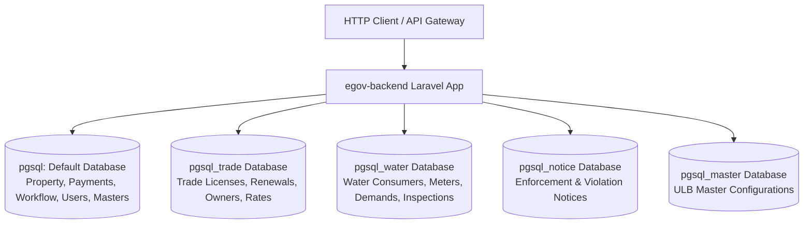

# Phase 1 Discovery: eGov Backend Project Structure & Architecture

## 1. Executive Overview

- **Project Path**: `/var/www/html/egov-backend`
- **Application Framework**: Laravel Framework `8.75.0`
- **PHP Version Compatibility**: `^7.3|^8.0`
- **Application Type**: Multi-module Municipal e-Governance Backend Service (Property Tax, Trade License, Water Usage Charges, Workflow Engine, Payment Reconciliation, Citizen Desk, Grievance, Notices)
- **Deployment & Architecture Model**: Microservices/Gateway-backed Stateless Domain Service. Request authentication and bearer token verification occur upstream at the API Gateway (`Authorisation-Service`), which injects identity payloads (`$request->auth` and `$request->currentAccessToken`) into incoming HTTP requests. The backend consumes these via custom middleware (`AuthMaker`).
- **Database Model**: Multi-Database PostgreSQL setup (`pgsql` for Core/Property, `pgsql_trade` for Trade License, `pgsql_water` for Water Management, `pgsql_master` for Master configurations, plus dedicated connections for advertisements, notices, fines, and reports).

---

## 2. Directory Tree & Structural Layout

```text
/var/www/html/egov-backend/
├── app/
│   ├── BLL/                     # Business Logic Layer (17 files)
│   │   ├── AddNotification.php
│   │   ├── DocUrl.php
│   │   ├── Property/            # 14 Property-specific calculation/business rule engines
│   │   └── Water/               # Water transaction deactivation engine
│   ├── Console/                 # Artisan commands and scheduler Kernel
│   │   ├── Commands/
│   │   └── Kernel.php
│   ├── EloquentClass/           # Tax & Penalty computation domain entities (3 files)
│   │   └── Property/            # InsertTax.php, PenaltyRebateCalculation.php, SafCalculation.php
│   ├── EloquentModels/          # Common Eloquent mapping models
│   ├── Exceptions/              # Custom exception handler & CustomRequestException
│   ├── Helpers/                 # Shared domain helper functions
│   │   ├── sms_helper.php       # SMS gateway integrations & templates
│   │   ├── utility_helper.php   # Standard response formatters, money, date, and math helpers
│   │   └── whatsapp_helper.php  # WhatsApp alert integration
│   ├── Http/
│   │   ├── Controllers/         # Application controllers (44 controllers involved in target modules)
│   │   │   ├── Property/        # 24 Property controllers
│   │   │   ├── Trade/           # 5 Trade controllers
│   │   │   ├── Water/           # 8 Water controllers
│   │   │   ├── Payment/         # Payment & reconciliation controllers
│   │   │   ├── WorkflowMaster/  # Workflow configuration controllers
│   │   │   ├── Workflows/       # Workflow runtime tracking controllers
│   │   │   ├── Dashboard/       # Dashboard controllers (JSK, State, District)
│   │   │   ├── Mdm/             # Trade Master Data Management
│   │   │   └── *.php            # Shared controllers (Citizen, Caretaker, Reference, Ulb, Demo)
│   │   ├── Middleware/          # 17 Custom and framework middleware
│   │   │   ├── AuthMaker.php    # Gateway token-to-user session hydration
│   │   │   ├── ApiKeyMiddleware.php # API Key validation
│   │   │   ├── ApiLogger.php    # Structured execution & failure logger
│   │   │   ├── ForceJsonResponse.php # Header Accept: application/json enforcement
│   │   │   └── ...
│   │   └── Requests/            # FormRequest validation classes (47 files)
│   │       ├── Property/        # SAF, Bifurcation, Deactivation, Site verification requests
│   │       ├── Trade/           # Trade apply, renewal, notice, payment requests
│   │       └── Water/           # Water apply, site inspection, payment, meter requests
│   ├── MicroServices/           # Standalone service clients & generators
│   │   ├── DocUpload.php        # Centralized Document Upload microservice client
│   │   ├── IdGeneration.php     # Application/Certificate ID generation service
│   │   └── IdGenerator/         # HoldingNoGenerator, PrefixIdGenerator, PropIdGenerator
│   ├── Models/                  # Eloquent models (166 total model files)
│   │   ├── Property/            # 78 Property domain models
│   │   ├── Trade/               # 26 Trade domain models
│   │   ├── Water/               # 50 Water domain models
│   │   ├── Workflows/           # 9 Workflow engine models
│   │   ├── Payment/             # 14 Payment & transaction models
│   │   └── *.php                # Shared master, menu, announcement, and system models
│   ├── Observers/               # Eloquent model observers
│   ├── Pipelines/               # Pipeline Pattern filters (21 files)
│   │   ├── CareTakers/          # Caretaker property/trade assignment pipelines
│   │   ├── ConcessionInbox/     # Concession application inbox search pipelines
│   │   ├── GbSafInbox/          # Government building SAF pipelines
│   │   ├── HarvestingInbox/     # Rainwater harvesting search pipelines
│   │   ├── ObjectionInbox/      # Property objection inbox pipelines
│   │   └── SafInbox/            # SAF application search pipelines (by AppNo, Mobile, Name)
│   ├── Providers/               # Service Providers (App, Auth, Event, Route)
│   ├── Repository/              # Repository Layer (75 files: Interface + Concrete)
│   │   ├── Property/            # SAF, Objection, Concession, Deactivation, Bifurcation repos
│   │   ├── Trade/               # Trade, TradeCitizen, TradeNotice, Report repos
│   │   ├── Water/               # NewConnection, Consumer repos
│   │   ├── Workflow/            # Workflow state management repos
│   │   ├── Payment/             # Payment processing repos
│   │   └── Common/              # Common utility functions repo
│   └── Traits/                  # Domain & operational traits (25 files)
│       ├── Property/            # SAF, Concession, Objection, WardPermission, PropertyCal
│       ├── Trade/               # TradeTrait
│       ├── Water/               # WaterTrait, WaterRequestTrait
│       ├── Workflow/            # Workflow, WorkflowTrack traits
│       └── UlbFilter.php        # Multi-tenant ULB scoping trait
├── config/                      # Configuration files (app, database, auth, cors, module-constants)
├── database/
│   ├── migrations/              # Database migration schemas
│   └── seeders/                 # Database reference seeders
├── routes/                      # Route definitions
│   ├── api.php                  # Global API routes & shared references (19 KB)
│   ├── property.php             # Property module routes (58 KB, 528 routes)
│   ├── trade.php                # Trade module routes (8.7 KB, 88 routes)
│   ├── water.php                # Water module routes (18.4 KB, 142 routes)
│   ├── workflow.php             # Workflow engine routes (7.2 KB, 61 routes)
│   ├── payment.php              # Payment module routes (5 KB)
│   ├── dashboard.php            # Dashboard routes (1.5 KB)
│   ├── notice.php               # Notice routes (0.9 KB)
│   ├── grievance.php            # Grievance routes (0.7 KB)
│   ├── bug.php                  # Bug reporting routes (2.1 KB)
│   └── channels.php / console.php / web.php
└── public/                      # Static entry points and file assets
```

---

## 3. Technology Stack & Key Dependencies

Inspected directly from `/var/www/html/egov-backend/composer.json`:

| Package | Version | Architectural Role |
|---|---|---|
| `laravel/framework` | `^8.75` | Core MVC framework and routing engine |
| `php` | `^7.3\|^8.0` | Execution runtime |
| `barryvdh/laravel-dompdf` | `^2.0` | PDF certificate & receipt generation (Holding Tax receipts, Trade licenses, Water bills) |
| `fruitcake/laravel-cors` | `^2.0` | Cross-Origin Resource Sharing handling |
| `guzzlehttp/guzzle` | `^7.0.1` | HTTP client for external microservices (Document upload, SMS gateways) |
| `intervention/image` | `^2.7` | Image processing for photo and site inspection uploads |
| `laravel/sanctum` | `^2.15` | Stateful API token guard scaffolding |
| `predis/predis` | `^2.0` | Redis cache and session management |
| `razorpay/razorpay` | `2.*` | Payment gateway SDK for citizen payments |
| `seshac/otp-generator` | `^0.0.7` | Mobile verification OTP generator |
| `web-token/jwt-*` | `^3.2` | JWT token decoding, signature, and encryption validation |
| `willdurand/geocoder` | `^4.6` | Geographic mapping and coordinates lookup |

---

## 4. Route Registration Mechanism

All routes are registered inside `app/Providers/RouteServiceProvider.php`:

```php
// Property Module (routes/property.php)
Route::prefix('api/property')
    ->middleware('api')
    ->namespace($this->namespace)
    ->group(base_path('routes/property.php'));

// Trade Module (routes/trade.php)
Route::prefix('api/trade')
    ->middleware('api')
    ->namespace($this->namespace)
    ->group(base_path('routes/trade.php'));

// Water Module (routes/water.php) - CRITICAL ANOMALY: Registered TWICE
Route::prefix('api/water')
    ->middleware('api')
    ->namespace($this->namespace)
    ->group(base_path('routes/water.php'));

Route::prefix('api/water')
    ->namespace($this->namespace)
    ->group(base_path('routes/water.php'));
```

### Architectural Findings on Route Registration:
1. **Water Route Overwrite / Anomaly**: In `RouteServiceProvider.php`, `routes/water.php` is imported twice. The second group declaration omits the `'api'` middleware group (`EnsureFrontendRequestsAreStateful`, `throttle:api`, `SubstituteBindings`). In Laravel's `RouteCollection`, the second registration overwrites matching endpoints in the routing table, resulting in water routes executing without the `'api'` middleware group wrapper, though the inner route-group middleware (`json.response`, `auth_maker`) remains active.
2. **Inner Route Middleware Groups**:
   - `routes/property.php` wraps all business endpoints in `['json.response', 'auth_maker', 'apilogger']`.
   - `routes/trade.php` wraps business endpoints in `['json.response', 'auth_maker']`.
   - `routes/water.php` wraps endpoints in `['json.response', 'auth_maker']`.
3. **Public / Unauthenticated Routes**:
   - Health checks: `GET /api/property/health-check`, `GET /api/trade/health-check`, `GET /api/water/health-check`.
   - Public certificates: `GET /api/trade/payment-receipt/{id}/{transectionId}`, `GET /api/trade/provisional-certificate/{id}`, `GET /api/trade/license-certificate/{id}`.
   - Public document upload: `POST /api/water/simple-upload-document`.

---

## 5. Database Architecture & Connection Topology

Configured inside `config/database.php`. The system implements multi-database segmentation:



### Connection Matrix:
- **`pgsql` (Default Connection)**: Used by `App\Models\Property\*`, `App\Models\Workflows\*`, `App\Models\Payment\*`, `App\Models\User`, `App\Models\ActiveCitizen`, and reference tables.
- **`pgsql_trade`**: Used by `App\Models\Trade\*`. Base class `TradeParamModel` sets `$this->connection = "pgsql_trade"`.
- **`pgsql_water`**: Used by `App\Models\Water\*`. Base class `WaterParamModel` and individual water models specify `protected $connection = "pgsql_water"`.
- **`pgsql_master` / `pgsql_notice` / `pgsql_reports`**: Dedicated schemas/databases for state-wide reports, notices, and shared configuration.

---

## 6. Execution Flow Architectural Pattern

The application enforces a multi-tiered pipeline:

```text
Request (HTTP POST/GET)
   │
   ▼
[RouteServiceProvider] (Prefix: api/property, api/trade, api/water)
   │
   ▼
[Middleware Pipeline]
   ├── ForceJsonResponse (Enforces Accept: application/json)
   ├── AuthMaker (Extracts $request->auth, logs in User or ActiveCitizen)
   └── ApiLogger (Times execution, records structured logs in apilogs channel)
   │
   ▼
[Controller Method]
   │
   ▼
[Validation Layer]
   ├── FormRequest (e.g. reqApplySaf, TradeRequest, ReqApplicationId)
   ├── Validator::make inline
   └── Custom $this->validation($request)
   │
   ▼
[Business Logic Layer (BLL) / Calculation Engine]
   ├── Property: CalculateSafById, SafApprovalBll, YearlyDemandGeneration
   ├── EloquentClass: SafCalculation, InsertTax, PenaltyRebateCalculation
   └── Microservices: DocUpload, IdGeneration
   │
   ▼
[Repository Layer] (Interface & Concrete)
   ├── Handles data access orchestration & transaction management (DB::beginTransaction)
   └── Applies Query Pipelines (SafInbox, CareTakers, SearchHolding)
   │
   ▼
[Eloquent Models & Query Builder]
   └── Executes SQL queries on pgsql / pgsql_trade / pgsql_water
   │
   ▼
[Standard JSON Response]
   └── Formatted via responseMsgs($status, $message, $data, $apiId, $version, $responseTime)
```

This structural blueprint forms the foundation for the deep investigations in the succeeding documents.

