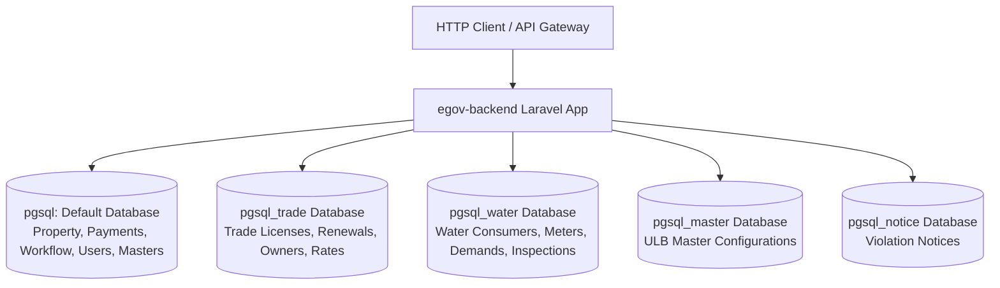

# Phase 1 Discovery: eGov Backend Project Structure & Architecture (Verified & Corrected)

## 1. Executive Overview

- **Project Path**: `/var/www/html/egov-backend`
- **Application Framework**: Laravel Framework `8.75.0` (`composer.json:15`)
- **PHP Version Compatibility**: `^7.3|^8.0` (`composer.json:10`)
- **Application Type**: Multi-tenant, multi-database Municipal e-Governance Backend Service (Property Tax, Trade License, Water Usage Charges, Workflow Engine, Payment Reconciliation, Citizen Desk, Grievance, Notices)
- **Deployment & Architecture Model**: Stateless Microservice / Gateway-backed Domain Service. Request authentication and bearer token verification occur upstream at the API Gateway (`Authorisation-Service`), which injects serialized user identity payloads (`$request->auth` and `$request->currentAccessToken`) into incoming HTTP requests. The backend consumes these via [`App\Http\Middleware\AuthMaker`](file:///var/www/html/egov-backend/app/Http/Middleware/AuthMaker.php#L19-L43).
- **Database Model**: Multi-Database PostgreSQL architecture configured in [`config/database.php:65-125`](file:///var/www/html/egov-backend/config/database.php#L65-L125) (`pgsql` for Core/Property/Workflows/Payments, `pgsql_trade` for Trade License, `pgsql_water` for Water Management, `pgsql_master` for Master configurations, plus dedicated connections for advertisements, notices, fines, and reports).
- **Verification Status**: `VERIFIED`

---

## 2. Directory Tree & Structural Layout

```text
/var/www/html/egov-backend/
├── app/
│   ├── BLL/                     # Business Logic Layer (17 files)
│   │   ├── AddNotification.php  # Multi-channel notification dispatcher
│   │   ├── DocUrl.php           # DMS pre-signed URL resolver
│   │   ├── Property/            # 14 Property-specific calculation/business rule engines
│   │   └── Water/               # 1 Water transaction deactivation engine
│   ├── Console/                 # Artisan commands and scheduler Kernel
│   │   ├── Commands/
│   │   └── Kernel.php
│   ├── EloquentClass/           # Tax & Penalty computation domain entities (3 files)
│   │   └── Property/            # InsertTax.php, PenaltyRebateCalculation.php, SafCalculation.php
│   ├── EloquentModels/          # Common Eloquent mapping models
│   ├── Exceptions/              # Custom exception handler & CustomRequestException
│   ├── Helpers/                 # Shared domain helper functions
│   │   ├── sms_helper.php       # SMS gateway integrations & templates
│   │   ├── utility_helper.php   # Standard response formatters (responseMsgs), financial year, math
│   │   └── whatsapp_helper.php  # WhatsApp alert integration
│   ├── Http/
│   │   ├── Controllers/         # Application controllers (42 controllers in app/Http/Controllers/)
│   │   │   ├── Property/        # 24 Property domain controllers
│   │   │   ├── Trade/           # 5 Trade domain controllers
│   │   │   ├── Water/           # 8 Water domain controllers
│   │   │   ├── Payment/         # Payment & reconciliation controllers
│   │   │   ├── WorkflowMaster/  # Workflow configuration controllers
│   │   │   ├── Workflows/       # Workflow runtime tracking controllers
│   │   │   ├── Dashboard/       # Dashboard controllers (JSK, State, District)
│   │   │   ├── Mdm/             # Trade Master Data Management (TradeController.php)
│   │   │   └── *.php            # Shared controllers (Citizen, Caretaker, Reference, Ulb, Demo)
│   │   ├── Middleware/          # 17 Custom and framework middleware
│   │   │   ├── AuthMaker.php    # Gateway token-to-user session hydration
│   │   │   ├── ApiKeyMiddleware.php # API Key validation
│   │   │   ├── ApiLogger.php    # Structured execution & failure logger
│   │   │   ├── ForceJsonResponse.php # Header Accept: application/json enforcement
│   │   │   └── ...
│   │   └── Requests/            # FormRequest validation classes (47 files)
│   │       ├── Property/        # SAF, Bifurcation, Deactivation, Site verification requests
│   │       ├── Trade/           # Trade apply, renewal, notice, payment requests
│   │       └── Water/           # Water apply, site inspection, payment, meter requests
│   ├── MicroServices/           # Standalone service clients & generators (6 files)
│   │   ├── DocUpload.php        # Centralized Document Upload microservice client
│   │   ├── IdGeneration.php     # Application/Certificate ID generation service
│   │   └── IdGenerator/         # HoldingNoGenerator, PrefixIdGenerator, PropIdGenerator
│   ├── Models/                  # Eloquent models (166 total model files)
│   │   ├── Property/            # 78 Property domain models
│   │   ├── Trade/               # 26 Trade domain models
│   │   ├── Water/               # 50 Water domain models
│   │   ├── Workflows/           # 9 Workflow engine models
│   │   ├── Payment/             # 14 Payment & transaction models
│   │   └── *.php                # Shared master, menu, announcement, and system models
│   ├── Observers/               # Eloquent model observers
│   ├── Pipelines/               # Pipeline Pattern filters (21 files)
│   │   ├── CareTakers/          # Caretaker property/trade assignment pipelines
│   │   ├── ConcessionInbox/     # Concession application inbox search pipelines
│   │   ├── GbSafInbox/          # Government building SAF pipelines
│   │   ├── HarvestingInbox/     # Rainwater harvesting search pipelines
│   │   ├── ObjectionInbox/      # Property objection inbox pipelines
│   │   └── SafInbox/            # SAF application search pipelines (by AppNo, Mobile, Name)
│   ├── Providers/               # Service Providers (App, Auth, Event, Route, Repository)
│   ├── Repository/              # Repository Layer (75 files: Interface + Concrete)
│   │   ├── Property/            # SAF, Objection, Concession, Deactivation, Bifurcation repos
│   │   ├── Trade/               # Trade, TradeCitizen, TradeNotice, Report repos
│   │   ├── Water/               # NewConnection, Consumer repos (+ WaterNewConnection concrete used as route target)
│   │   ├── Workflow/            # Workflow state management repos
│   │   ├── Payment/             # Payment processing repos
│   │   └── Common/              # Common utility functions repo
│   └── Traits/                  # Domain & operational traits (25 files)
│       ├── Property/            # SAF, Concession, Objection, WardPermission, PropertyCal
│       ├── Trade/               # TradeTrait
│       ├── Water/               # WaterTrait, WaterRequestTrait
│       ├── Workflow/            # Workflow, WorkflowTrack traits
│       └── UlbFilter.php        # Multi-tenant ULB scoping trait & InternalUlbScope
├── config/                      # Configuration files (app, database, auth, cors, module-constants)
├── database/
│   ├── migrations/              # Database migration schemas
│   └── seeders/                 # Database reference seeders
├── routes/                      # Route definitions
│   ├── api.php                  # Global API routes & shared references (19 KB)
│   ├── property.php             # Property module routes (58 KB, 528 registered routes)
│   ├── trade.php                # Trade module routes (8.7 KB, 88 registered routes)
│   ├── water.php                # Water module routes (18.4 KB, 142 registered routes)
│   ├── workflow.php             # Workflow engine routes (7.2 KB, 61 registered routes)
│   ├── payment.php              # Payment module routes (5 KB)
│   ├── dashboard.php            # Dashboard routes (1.5 KB)
│   ├── notice.php               # Notice routes (0.9 KB)
│   ├── grievance.php            # Grievance routes (0.7 KB)
│   ├── bug.php                  # Bug reporting routes (2.1 KB)
│   └── channels.php / console.php / web.php
└── public/                      # Static entry points and file assets
```

---

## 3. Route Registration & Middleware Stack Reconciliation

Routes are loaded inside [`app/Providers/RouteServiceProvider.php:38-95`](file:///var/www/html/egov-backend/app/Providers/RouteServiceProvider.php#L38-L95).

```php
// Property Module (routes/property.php)
Route::prefix('api/property')
    ->middleware('api')
    ->namespace($this->namespace)
    ->group(base_path('routes/property.php'));

// Trade Module (routes/trade.php)
Route::prefix('api/trade')
    ->middleware('api')
    ->namespace($this->namespace)
    ->group(base_path('routes/trade.php'));

// Water Module (routes/water.php) - CRITICAL ANOMALY: Registered TWICE
Route::prefix('api/water')
    ->middleware('api')
    ->namespace($this->namespace)
    ->group(base_path('routes/water.php'));

Route::prefix('api/water')
    ->namespace($this->namespace)
    ->group(base_path('routes/water.php'));
```

### Route Registration Findings:
1. **Water Route Overwrite / Throttle Bypass (`SECURITY RISK`)**:
   - In [`RouteServiceProvider.php:46-56`](file:///var/www/html/egov-backend/app/Providers/RouteServiceProvider.php#L46-L56), `routes/water.php` is imported twice. The second pass lacks `->middleware('api')`.
   - In Laravel's `Illuminate\Routing\RouteCollection`, adding a route with the identical HTTP method and URI replaces the prior route.
   - **Actual Effect**: The second un-middlewared pass replaces the first pass in the routing table. Consequently, all 139 routes defined in `routes/water.php` run **WITHOUT the global `'api'` middleware group** (`EnsureFrontendRequestsAreStateful`, `throttle:api`, `SubstituteBindings`).
   - Rate limiting via `throttle:api` is completely bypassed across all Water endpoints.
   - Status: `SECURITY RISK` / `VERIFIED`

2. **Unauthenticated Overwrite in Trade (`SECURITY RISK`)**:
   - In `routes/trade.php:112`, `POST api/trade/application-search/get-owner-details` is declared inside `Route::group(['middleware' => ['json.response', 'auth_maker']], ...)`.
   - In `routes/trade.php:206`, the identical route `Route::post('application-search/get-owner-details', 'getOwnerDetailsInfo')` is declared at the bottom of the file outside the middleware group.
   - **Actual Effect**: The second declaration overwrites the first in the routing table, stripping `auth_maker` and `json.response`. The endpoint runs with only `middleware: ['api']`, allowing unauthenticated public callers to query trade license owner details by application or license number.
   - Status: `SECURITY RISK` / `VERIFIED`

3. **Property Reference Endpoint Duplication**:
   - `routes/api.php:377-400` declares reference master endpoints under `api/property/*` (e.g., `POST api/property/building-rental-const`).
   - `routes/property.php:464-490` declares the identical endpoints with identical controller methods (`ReferenceController@list*`).
   - **Actual Effect**: `routes/property.php` executes after `routes/api.php` in `RouteServiceProvider`, overwriting the entries in the routing table. Only `GET|POST|HEAD api/property/citizens/applied-applications` is unique to `routes/api.php`.
   - Status: `VERIFIED`

---

## 4. Reconciliation of Controller Counts (43 vs 44)

An apparent discrepancy exists between the count of 43 versus 44 controllers:

| Category | Count | Detailed Reconciliation |
|---|:---:|---|
| **Class-Based Controller Targets** | **43** | Exactly 43 PHP class files handle routes in Property, Trade, and Water. This consists of **42 controllers** located under `app/Http/Controllers/` plus **1 concrete repository** (`App\Repository\Water\Concrete\WaterNewConnection`) directly assigned as a route action in `routes/water.php:292`. |
| **Closure Pseudo-Controller** | **1** | Route closures handling inline endpoints (`api/property/api-test`, `api/property/health-check`, `api/trade/health-check`, `api/water/health-check`, `api/water/apply-new-connection`). |
| **Total Route Action Targets** | **44** | 43 class-based targets + 1 Closure target = **44 total targets** in Laravel's route collection. |

### Domain Breakdown of the 42 Controllers in `app/Http/Controllers/`:
- **Property-Specific Controllers (24)**: `ActiveSafController`, `ActiveSafControllerV2`, `ApplySafController`, `CalculatorController`, `ClusterController`, `ConcessionController`, `DocumentOperationController`, `GbSafController`, `HoldingTaxController`, `LocationController`, `MasterReferenceController`, `ObjectionController`, `PropMaster`, `PropertyBifurcationController`, `PropertyController`, `PropertyDeactivateController`, `PropertyDetailsController`, `RainWaterHarvestingController`, `ReportController` (Property), `SafCalculatorController`, `SafDocController`, `WaiverController`, `ZoneController`.
- **Trade-Specific Controllers (5)**: `TradeApplication`, `TradeCitizenController`, `TradeNoticeController`, `ReportController` (Trade), `TradeAutoForward` (daemon/cron helper).
- **Water-Specific Controllers (8)**: `ConsumerActionRequest`, `NewConnectionController`, `WaterApplication`, `WaterConsumer`, `WaterConsumerWfController`, `WaterMasterController`, `WaterPaymentController`, `WaterReportController`.
- **Shared / Cross-Module Controllers (6)**: `CaretakerController`, `CitizenController`, `DemoController`, `Mdm\TradeController`, `Payment\BankReconcillationController`, `Payment\CashVerificationController`, `ReferenceController`, `Dashboard\JskController`.

- Status: `VERIFIED`

---

## 5. Database Architecture & Connection Topology

Configured inside [`config/database.php:65-125`](file:///var/www/html/egov-backend/config/database.php#L65-L125):



### Connection Matrix:
- **`pgsql` (Default Connection)**: Bound to `env('DB_CONNECTION', 'pgsql')`. Utilized by `App\Models\Property\*`, `App\Models\Workflows\*`, `App\Models\Payment\*`, `App\Models\User`, `App\Models\ActiveCitizen`, and shared master tables.
- **`pgsql_trade`**: Utilized by `App\Models\Trade\*`. Base class [`TradeParamModel`](file:///var/www/html/egov-backend/app/Models/Trade/TradeParamModel.php#L14-L18) sets `$this->connection = $DB ?: "pgsql_trade"`.
- **`pgsql_water`**: Utilized by `App\Models\Water\*`. Base class [`WaterParamModel`](file:///var/www/html/egov-backend/app/Models/Water/WaterParamModel.php#L13-L17) and individual models declare `protected $connection = "pgsql_water"`.
- **`pgsql_master`**: Referenced in multi-connection transaction blocks (e.g. [`ActiveSafController::approvalRejectionSaf`](file:///var/www/html/egov-backend/app/Http/Controllers/Property/ActiveSafController.php#L1161)) for state-wide ULB configurations.
- Status: `VERIFIED`

---

## 6. Execution Flow Architectural Pattern

The application enforces a multi-tiered pipeline:

```text
Request (HTTP POST/GET)
   │
   ▼
[RouteServiceProvider] (Prefix: api/property, api/trade, api/water)
   │
   ▼
[Middleware Pipeline]
   ├── ForceJsonResponse (Enforces Accept: application/json)
   ├── AuthMaker (Extracts $request->auth, logs in User or ActiveCitizen)
   └── ApiLogger (Times execution, records structured logs in apilogs channel)
   │
   ▼
[Controller Method]
   │
   ▼
[Validation Layer]
   ├── FormRequest (e.g. reqApplySaf, ReqAddRecorde, newApplyRules)
   ├── Validator::make inline
   └── Custom $this->validation($request)
   │
   ▼
[Business Logic Layer (BLL) / Calculation Engine] (Direct or via Repository)
   ├── Property: CalculateSafById, SafApprovalBll, YearlyDemandGeneration
   ├── EloquentClass: SafCalculation, InsertTax, PenaltyRebateCalculation
   └── Microservices: DocUpload, IdGeneration, HoldingNoGenerator
   │
   ▼
[Repository Layer] (Interface bound in RepositoryServiceProvider)
   ├── Handles data access orchestration & transaction management (DB::beginTransaction)
   └── Applies Query Pipelines (SafInbox, CareTakers, SearchHolding)
   │
   ▼
[Eloquent Models & Query Builder]
   └── Executes SQL queries on pgsql / pgsql_trade / pgsql_water
   │
   ▼
[Standard JSON Response]
   └── Formatted via responseMsgs($status, $message, $data, $apiId, $version, $responseTime)
```

- Status: `VERIFIED`
