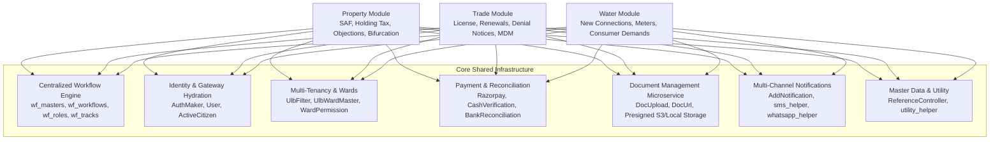

# Phase 1 Discovery: Shared Dependencies & Cross-Cutting Infrastructure (Verified & Corrected)

## 1. Executive Summary

While Property, Trade, and Water represent distinct municipal revenue streams with dedicated database connections (`pgsql`, `pgsql_trade`, `pgsql_water`), they converge on a shared architectural core. This document maps and analyzes every shared system component, database table, helper, and integration point connecting the three modules.



---

## 2. Shared Workflow State Machine (`app/Repository/Workflow/`)

The workflow engine governs state transitions, approval hierarchies, and audit logging across all three modules:

### A. Shared Workflow Database Schema
- `wf_masters`: Module definitions (`1 = Property`, `2 = Trade`, `3 = Water`).
- `wf_workflows`: Workflows within a module (e.g., SAF Workflow ID `10`, Trade Workflow ID `20`, Water New Connection ID `30`).
- `wf_roles`: Standard municipal designations:
  - Role `1`: Dealing Assistant (DA) - Initial document screening.
  - Role `2`: Tax Collector (TC) / Junior Engineer (JE) - Physical field inspection.
  - Role `3`: Section Officer / Revenue Inspector (RI) - Verification & demand approval.
  - Role `4`: Executive Officer (EO) / Municipal Commissioner - Final approval/rejection.
- `wf_workflowrolemaps`: Graph transition rules (e.g., Role 1 can forward to Role 2; Role 2 can forward to Role 3 or backward to Citizen).
- `wf_roleusermaps`: User-to-Role assignments partitioned by `ulb_id`.
- `wf_tracks`: Unified audit log of every action taken on an application across all modules:
  - Columns: `workflow_id`, `ref_table_id`, `ref_table_name_id`, `sender_role_id`, `receiver_role_id`, `verification_status`, `comment`, `forward_date`, `ulb_id`.
- **Status**: `VERIFIED`

---

## 3. Shared Identity & User Authentication

| Component | Shared Role across Property, Trade, Water | Verification Status |
|---|---|:---:|
| `AuthMaker` Middleware | Central entry point converting upstream Gateway auth headers into authenticated session instances (`app/Http/Middleware/AuthMaker.php:19-43`). | `VERIFIED` |
| `App\Models\User` | Municipal staff performing assessments, site inspections, and approvals across Property, Trade, and Water. | `VERIFIED` |
| `App\Models\ActiveCitizen` | Taxpayers applying for SAF, Trade Licenses, or Water Connections using their verified mobile phone number. | `VERIFIED` |
| `CaretakerController` | Special operational role allowing designated caretakers to manage properties, trade licenses, or water connections on behalf of owners. Shared routes exist in both `property.php` and `api.php`. | `VERIFIED` |

---

## 4. Multi-Tenancy & Spatial Mapping (ULBs & Wards)

Every municipal application requires strict jurisdictional binding:

### A. ULB Hierarchy
1. State Government (`states`)
2. District (`districts`)
3. Urban Local Body (`ulb_masters`): Contains ULB code, name, district ID, municipal logo URL, and contact details.
4. Municipal Wards (`ulb_ward_masters`): Geographic sub-divisions within a ULB.

### B. Cross-Database Querying & Property Holding Validation
- **Trade License Holding Validation** ([`app/Repository/Trade/Trade.php:67`](file:///var/www/html/egov-backend/app/Repository/Trade/Trade.php#L67)):
  - When applying for a Trade License, the applicant must provide a Property Holding Number.
  - `Trade::propertyDetailsfortradebyHoldingNo()` queries `prop_properties` on the default `pgsql` connection across database boundaries from `pgsql_trade` to verify holding validity and check for tax arrears!
- **Water Connection Holding Validation** ([`app/Http/Controllers/Water/NewConnectionController.php:658`](file:///var/www/html/egov-backend/app/Http/Controllers/Water/NewConnectionController.php#L658)):
  - `NewConnectionController::getSafHoldingDetails()` queries `prop_properties` and `prop_active_safs` on `pgsql` from `pgsql_water` to confirm property ownership before water connection approval.
- **`UlbFilter` Trait**: Injects `WHERE table.ulb_id = ?` across all models on all 3 database connections.
- **Status**: `VERIFIED`

---

## 5. Unified Payment Infrastructure

All revenue collection flows converge into a standardized payment architecture:

### A. Payment Channels Supported
1. **Online Citizen Gateway**: Integrated with Razorpay SDK (`razorpay/razorpay`).
   - Order creation: `RazorpayPaymentController::generateOrderId()`.
   - Webhook & transaction confirmation: Updates module transaction records (`prop_trans`, `trade_transactions`, `water_trans`).
2. **Cash Counter Payments**: Handled by Tax Collectors (TC) via Android POS or Web POS.
   - `CashVerificationController`: Collects physical cash, generates immediate thermal receipt, places transaction in "unverified" cash ledger.
   - End-of-Day Bank Deposit: Municipal cashier physically counts cash, matches TC collections, and approves via `CashVerificationController::cashVerify()`.
3. **Cheque / Demand Draft Clearing**:
   - `BankReconcillationController`: Records instrument number, bank branch, clearing date. Tracks dishonored/bounced cheques and automatically re-applies canceled tax demands with a cheque-bounce penalty.
- **Status**: `VERIFIED`

---

## 6. Document Upload Microservice (`DocUpload.php`)

All document storage (identity proofs, title deeds, building plans, electricity bills, site inspection photographs) is decoupled from the main database:

```text
Controller / Repository
   │  (Receives multipart/form-data)
   ▼
DocUpload::uploadDocument() [app/MicroServices/DocUpload.php:15-35]
   │  (Dispatches HTTP POST via Guzzle to Document Microservice)
   ▼
[Document Microservice / Cloud Bucket]
   │  (Saves file, returns relative document path / hash)
   ▼
Database Persistence
   ├── Property: prop_active_saf_docs
   ├── Trade: active_trade_documents
   └── Water: water_applicant_docs
   │
   ▼
DocUrl::getDocumentUrl() [app/BLL/DocUrl.php]
   └── Generates signed, tamper-proof viewing URL for verification screens
```
- **Status**: `VERIFIED`

---

## 7. Multi-Channel Notification Infrastructure

When an application moves through workflow stages, automated alerts are broadcast:

1. **`app/BLL/AddNotification.php`**: Dispatches system-wide alerts based on event triggers:
   - Application Submitted
   - Sent Back To Citizen (BTC) for missing documents
   - Demand Notice Generated
   - Application Approved / License Issued
2. **`sms_helper.php`**: Integrated with DLT-compliant Indian telecom SMS gateways (CDAC / JAPIT gateway). Sends template-registered SMS messages containing application numbers and tracking URLs.
3. **`whatsapp_helper.php`**: Integrated with official WhatsApp Business API endpoints for interactive notifications, bill PDF delivery, and chatbot holding lookups.
4. **`MirrorUserNotification`**: In-app notification center displayed on the citizen and employee portals.
- **Status**: `VERIFIED`

---

## 8. Shared Utilities & Reference Masters

1. **`utility_helper.php`**:
   - `responseMsgs($status, $msg, $data, $apiId, $version, $responseTime)`: Unified API response contract returning standard JSON schemas.
   - `getFinancialYear($date)`: Calculates Indian financial year string (e.g., `2024-2025`).
   - `amountInWords($number)`: Converts numerical currency amounts into English prose for printed receipts.
   - `carbonToDate($carbon)`: Timestamp formatting.
2. **`ReferenceController`**:
   - Shared lookup endpoints powering frontend dropdown menus: road types, construction types, occupancy types, trade categories, water connection sizes.
- **Status**: `VERIFIED`

---

## 9. Dependency Matrix Summary

| Dependency Component | Property | Trade | Water | Inter-Module Interaction | Status |
|---|:---:|:---:|:---:|---|:---:|
| **Workflow Engine (`wf_*`)** | Yes | Yes | Yes | Shared database tables, shared audit log (`wf_tracks`) | `VERIFIED` |
| **`AuthMaker` Middleware** | Yes | Yes | Yes | Shared user session hydration | `VERIFIED` |
| **`UlbFilter` Multi-Tenancy** | Yes | Yes | Yes | Shared database scoping across 3 distinct DB connections | `VERIFIED` |
| **`WardPermission`** | Yes | Yes | Yes | Shared Redis permission caching | `VERIFIED` |
| **Razorpay Payment Gateway** | Yes | Yes | Yes | Shared order generation & webhook reconciliation | `VERIFIED` |
| **Cash Verification** | Yes | Yes | Yes | Centralized municipal cashier ledger | `VERIFIED` |
| **Cheque Reconciliation** | Yes | Yes | Yes | Shared bank clearance and bounce penalty logic | `VERIFIED` |
| **`DocUpload` Microservice**| Yes | Yes | Yes | Centralized storage endpoint for all uploaded PDFs & images | `VERIFIED` |
| **`DocUrl` BLL** | Yes | Yes | Yes | Shared URL resolution engine | `VERIFIED` |
| **`AddNotification`** | Yes | Yes | Yes | Unified SMS and WhatsApp delivery | `VERIFIED` |
| **Property Holding Lookup** | Self | **Cross-DB** | **Cross-DB** | Trade and Water validate holding numbers against Property | `VERIFIED` |
| **`utility_helper.php`** | Yes | Yes | Yes | Shared standard JSON response format | `VERIFIED` |
